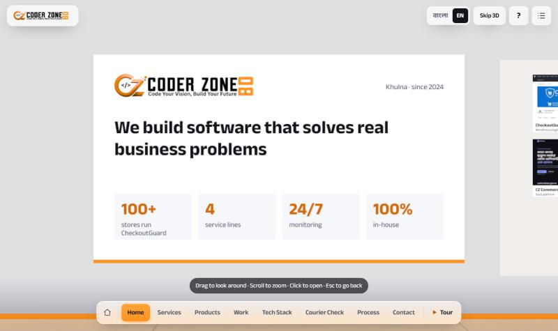
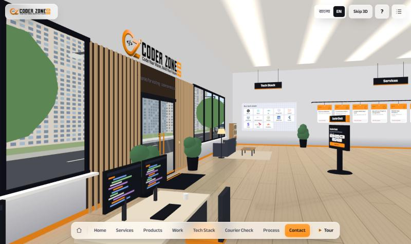
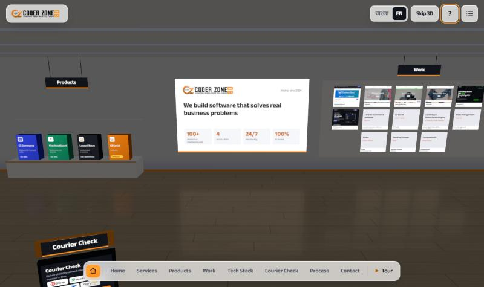
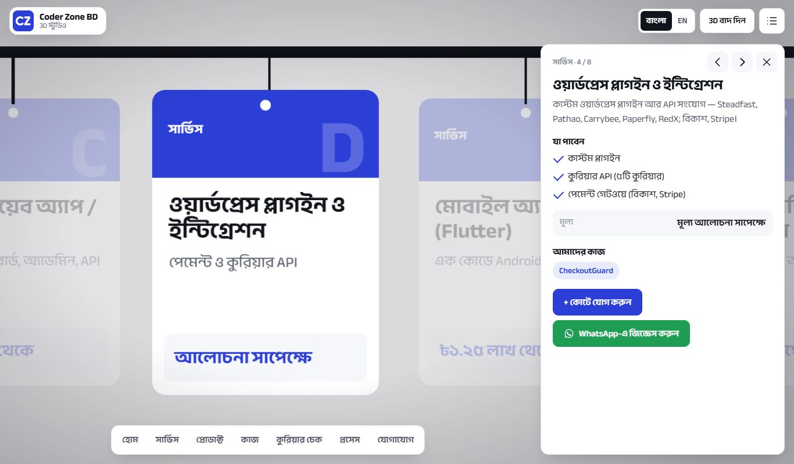
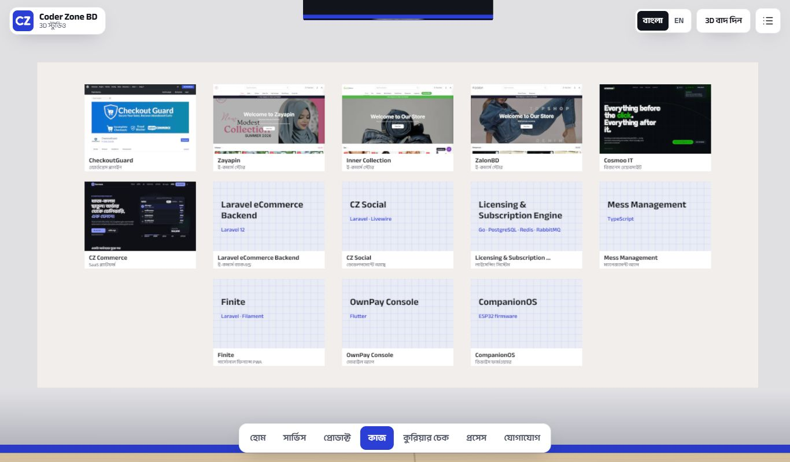
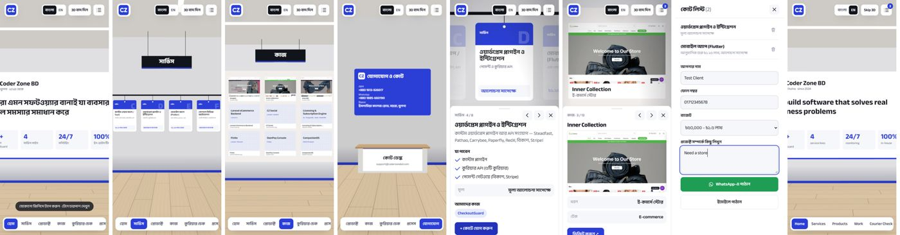

# Coder Zone BD · 3D Studio

A walk-through 3D office and showroom for [Coder Zone BD](https://coderzonebd.com), a software studio in Khulna. Visitors look around the studio, fly between eight sections, open any service, product or project, build a quote list, and send it on WhatsApp. The site is in English by default, with a Bangla toggle.

**Live:** https://3d.coderzonebd.com/








## What's in the room

| # | Section | Where | What it shows |
| --- | --- | --- | --- |
| 1 | Home | back wall, centre | Logo wall with the headline and stats. Its panel covers the company and why to choose us |
| 2 | Services | left wall, hanging rail | 8 cards. Each panel has what you get, an approximate price, duration, proof projects, **Add to quote** and WhatsApp buttons |
| 3 | Products | back-left plinth | CZ Commerce, CheckoutGuard, Laravel Ecom and CZ Social (coming soon), with real logos, pricing and links |
| 4 | Work | back-right wall | 13 projects. The live sites use real screenshots; projects without a public site get a neutral name + stack card |
| 5 | Tech Stack | left wall, front | A board of the real logos of the tools we use (Laravel, React, Flutter, WordPress, …) |
| 6 | Courier Check | centre kiosk | The free courier-history tool, with the real courier logos. **Check now** opens coderzonebd.com/courier-check |
| 7 | Process | right wall | Discover → Design & Build → Launch → Support |
| 8 | Contact | front-right desk | Contact details, team and FAQ. The quote list opens from here |

Brand: the real Coder Zone BD logo and wordmark, orange `#FF931E` on ink `#12141C`.

### A living office

- **Real Bangladesh time.** Through the windows and the glass entrance, the street follows the time in Dhaka (GMT+6): dawn, day, dusk and night, with the sun or moon, lit building windows and street lights after dark. `?time=day|dawn|dusk|night` forces a phase.
- **Real Khulna weather.** The street shows the current weather in Khulna, from [Open-Meteo](https://open-meteo.com) (free, no key, checked every 15 minutes, clear sky if it can't be reached). Cloudy: grey clouds drift across the sky. Rain: rain falls over the street, drops run down the windows and the glass doors, the road turns dark and wet, rickshaws get clear plastic covers, their riders rain capes, and people walk under umbrellas. Storm: rain plus lightning that lights up the sky and the room for a moment, and thunder when sound is on. Fog: the far buildings fade into haze. `?weather=clear|cloudy|rain|storm|fog` forces a state.
- **Bangladeshi festivals.** Chosen by today's date in Bangladesh. Pohela Boishakh (14 April): alpona floor art at the entrance, red-and-white bunting and a "শুভ নববর্ষ" banner. Eid ul-Fitr and Eid ul-Adha (from the Islamic calendar, give or take a day): twinkling fairy lights (morich bati) along the front wall, the windows and the door, and an "Eid Mubarak / ঈদ মোবারক" sign. 21 February: a small Shaheed Minar with flowers by the entrance and "অমর একুশে". 26 March and 16 December: a Bangladesh flag flying outside and green-and-red bunting. 1 January: a "Happy New Year" banner and gold bunting. The greeting hangs over the door inside and above the canopy outside. `?fest=boishakh|eid|ekushe|independence|victory|newyear` forces one.
- **Street life.** Cars, a bus, green CNG auto-rickshaws and cycle rickshaws with painted hoods (the riders pedal, the wheels turn) pass outside. People walk along both pavements, and birds cross the sky by day.
- **The team at work.** Two people type at their desks (and stretch now and then), while a third walks between the coffee corner and the lounge, sipping from a mug.
- **Everything moves a little.** Ceiling fans spin, the AC louver sweeps, steam rises from a coffee cup, the router's lights blink, code scrolls on the monitors, the plants sway and the service cards swing gently on their wires. Turn the lights off and the fans wind down too.
- **Digital clock.** An LED clock centred above the Home wall shows Dhaka time with ticking seconds, a blinking colon and the date.
- **Glass entrance.** Double glass doors in slim black frames, with tall orange pulls and an etched "CODER ZONE BD" band, set in walnut and oak-slat panels. The street shows through.
- **Office furniture.** Two workstations with code on the monitors, a lounge with a sofa and floor lamp, a bookshelf, a coffee corner, plants, and a wall clock showing Dhaka time.
- **Premium finish.** Recessed ceiling light strips with a soft glow, a satin floor that reflects the displays (desktop only), and frosted-glass controls.
- **Intro.** On the first visit of a session the camera starts across the street, crosses to the storefront (backlit sign, orange canopy, glass doors), the doors swing open with a chime and the camera walks in. **Skip intro**, Esc or Enter skips it; it never plays with reduced motion, a deep link or `?nointro`.
- **Real 3D models.** The lounge sofa, armchair, coffee and side tables, potted plants, ceiling fans, desk lamp, framed art and the CCTV camera are real CC0 models from Poly Haven. **CZ Bot**, the robot receptionist by the quote desk, waves when you arrive at Contact or hover it, gives a thumbs-up when you add to the quote, and opens Contact when clicked.
- **Baked-looking light.** Soft contact shadows under everything on the floor (live on desktop, rendered once on phones), shading where walls meet the ceiling and each other, and sunlight patches through the windows that follow the time of day.
- **Sound** (off until you turn it on, top bar). Synthesised live with Web Audio, so there are no sound files: fan and AC hum, distant traffic, keyboard typing, rickshaw bells, the odd horn, birds by day, a door chime, and soft ticks when you move around.

## How to explore

| Desktop | Phone | What it does |
| --- | --- | --- |
| Drag | Drag with one finger | Look around, all 360° |
| Scroll | Pinch | Zoom in and out (lens zoom, so the camera never goes through a wall) |
| Click | Tap | Open an item, or click a section's empty space to fly there |
| Esc | | Step back one level: close the help, the quote list or the panel, then show the whole studio |
| ← → | | Previous / next section (inside a panel: previous / next item) |
| 1 – 8 | | Jump straight to a section |
| T | ▶ Tour button | Auto tour through every section; any click, drag, scroll or key stops it |
| L | Light switch by the door | Office lights on / off (daylight through the windows stays) |
| ? or H | ? button | The "How to explore" help |
| O | ⌂ button | Overview of the whole studio |

On desktop, a label next to the pointer says what you're about to open ("Go to Work →", the service name, and so on).

Things to click in the office: the **wall clock** tells you the time in Dhaka, the **coffee machine** takes you to Contact, the **monitors** take you to Work, the **door** shows the whole studio, and the **switch** by the door turns the lights off.

Clicking an item zooms to it and opens a side panel; on phones the panel is a bottom sheet. The quote list (top right) collects services, then takes a name, phone, budget and note. **Send on WhatsApp** opens `wa.me/8801885660190` with the whole list prefilled, and **Send by email** is the fallback.

## 2D version, SEO and slow devices

- All of the content is also plain semantic HTML (`src/flat/FlatSite.tsx`). It is **prerendered into `index.html` at build time**, so search engines and slow connections get the full text before any JavaScript runs.
- **Skip 3D** in the top bar switches to that 2D page. The site starts in 2D automatically when WebGL is missing or software-only, when the device has less than 3 GB of memory, or when Save-Data is on. A visitor's own choice is remembered.
- In 3D, the render resolution adapts to the frame rate instead of dropping to 2D. If the GPU loses the WebGL context, the canvas rebuilds itself.
- In 3D mode the 2D page stays in the DOM (visually hidden) for screen readers. Keyboard users who tab into it get it as a full overlay.
- With reduced motion turned on, the camera jumps between sections instead of flying.
- `?2d` / `?3d` / `?lang=bn` / `?time=night` / `?weather=rain` / `?fest=eid` in the URL force a mode, language, time of day, weather or festival.

**Weight:** in 2D mode, three.js is never downloaded. 3D adds about 300 KB gzipped of JS plus the screenshots and logos. Everything else in the room is drawn on `<canvas>` at runtime.

## Stack

Vite, React 18, TypeScript, React Three Fiber + drei (`CameraControls` for the camera, `MeshReflectorMaterial` for the floor, `PerformanceMonitor` for adaptive resolution), zustand, and the self-hosted Anek Bangla font (OFL, `src/fonts/OFL.txt`).

| File | What's in it |
| --- | --- |
| `src/content.ts` | All text (English + Bangla), prices, products, projects, process, FAQ, contacts, UI strings |
| `src/store.ts` | App state: section, focus, overview, tour, lights, help, quote list |
| `src/three/Room.tsx` | Walls, floor, ceiling lights, displays, glass entrance, light switch |
| `src/three/Office.tsx` | Furniture, wall clock, clickable office objects |
| `src/three/Life.tsx` | The animated team, fans, AC, steam, router, digital clock |
| `src/three/Street.tsx` | Rickshaws, CNGs, pedestrians, birds |
| `src/three/Models.tsx` | Real 3D models and the CZ Bot receptionist |
| `src/weather.ts`, `src/three/Weather.tsx` | Live Khulna weather (Open-Meteo) and the clouds, rain, fog and lightning outside |
| `src/three/Festivals.tsx` | Festival dates and decorations |
| `src/audio.ts` | The synthesised office and street sound |
| `src/three/Outside.tsx` | Sky, buildings, street, traffic, day/night |
| `src/three/CameraRig.tsx` | Camera moves, look-around, zoom, overview |
| `src/components/Interact.tsx` | Keyboard shortcuts, auto tour, pointer label, help overlay |

## 3D models and credits

All models are CC0 (public domain), in `public/models/`, meshopt-compressed with textures cut to 512 px (about 2.9 MB in total, loaded after the room appears):

- Furniture, plants and props: [Poly Haven](https://polyhaven.com/models) (CC0)
- CZ Bot: "RobotExpressive" by Tomás Laulhé / [Quaternius](https://quaternius.com), via the three.js examples (CC0)

To add one: download the glTF from Poly Haven at 1k, shrink its textures, then run `gltf-transform optimize in.gltf public/models/name.glb --compress meshopt --texture-compress false`, and place it in `src/three/Models.tsx`.

## Edit the content

Everything is in **`src/content.ts`**. The 3D room, the panels and the 2D page all read from it.

- Add a service or project and it gets a place on the rail or the wall automatically (`src/three/layout.ts`).
- To give a project a real screenshot, save `public/work/<id>.jpg` (960×600) and `public/work/<id>-thumb.jpg` (512×320), then set `shot: true`.
- Logos live in `public/logos/`.
- Testimonials are off on purpose. Once there are real ones, fill `TESTIMONIALS` and set `SHOW_TESTIMONIALS = true`.

## Run locally

```bash
npm install
npm run dev
```

Then open http://localhost:5173/

`npm run build` type-checks, builds, server-renders the 2D page into `dist/index.html`, and writes everything to `dist/`.

## Deploy

Every push to `main` triggers `.github/workflows/deploy.yml`, which builds the site and publishes it to GitHub Pages at **3d.coderzonebd.com** (`public/CNAME`). The site builds at the root path by default; set `BASE_PATH=/repo-name/` to host it under a project path instead.
